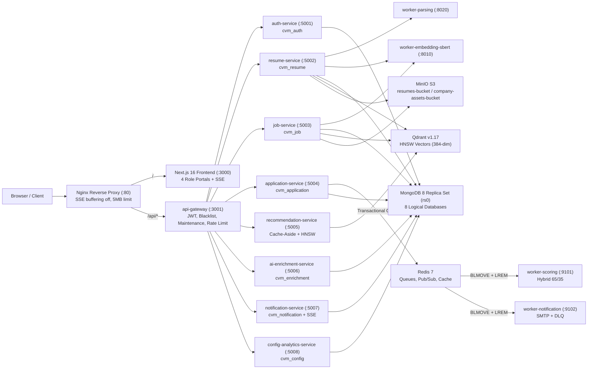

# CV-Matching Microservices Platform


Nền tảng Tuyển dụng & So khớp CV ứng dụng AI (Hybrid Semantic + Keyword Scoring), thiết kế theo kiến trúc **Microservices + Event-Driven + API Gateway (Strangler Fig 100%)** với **4 cổng vai trò RBAC** (`candidate`, `recruiter`, `tech_staff`, `platform_owner`).

---

## Kiến trúc Tổng thể (17+ Containers)



### Tách Cơ sở dữ liệu (Database-per-Service trên MongoDB 8 Replica Set `rs0`)

| Microservice | Port | Logical Database | Trách nhiệm chính |
| :--- | :---: | :--- | :--- |
| `api-gateway` | `3001` | — | Reverse Proxy 100% `/api/*`, JWT Verify, Redis Blacklist, Maintenance Guard, Rate Limit |
| `auth-service` | `5001` | `cvm_auth` | Đăng ký/Đăng nhập, Refresh Token Rotation, Brute-Force Lockout, PII AES-256-GCM |
| `resume-service` | `5002` | `cvm_resume` | Upload CV (4MB, Magic Bytes), MinIO S3, gọi `worker-parsing` & `worker-embedding-sbert`, Qdrant `resumes_vectors` |
| `job-service` | `5003` | `cvm_job` | CRUD Job & Company (MST), Qdrant `jobs_vectors`, phát `JOB_STATUS_CHANGED` |
| `application-service` | `5004` | `cvm_application` | Transactional Outbox ACID, `JobStatusMirror`, State Machine, OCC (`__v`), BulkWrite `<= 500` |
| `recommendation-service` | `5005` | — (stateless) | Tìm kiếm Job Cache-Aside (300s), HNSW Cosine (`>= 0.60`), Keyword Fallback (`1.5s` timeout) |
| `ai-enrichment-service` | `5006` | `cvm_enrichment` | Tối ưu CV (1h cache), Cover Letter, Outreach, Bộ câu hỏi phỏng vấn (chặn chéo RBAC), Quota 10/ngày, `template_fallback` |
| `notification-service` | `5007` | `cvm_notification` | Idempotent Notification, SSE `/api/notifications/stream` (25s heartbeat, `Last-Event-ID`), `notification_queue` |
| `config-analytics-service` | `5008` | `cvm_config` | Cấu hình động (`scoringWeights` 65/35, `maintenanceMode`), `CONFIG_UPDATED`, Audit Logs, DLQ Replay, Qdrant Alias Swap, Owner BI |

### Ma trận 4 Vai trò (4-Role RBAC)

| Vai trò | Cổng giao diện | Chức năng trọng tâm |
| :--- | :--- | :--- |
| `candidate` | `/candidate/*` | Tải/tạo CV, tìm kiếm & nhận gợi ý việc làm AI, nộp/lưu nháp/rút đơn (`WITHDRAW`), luyện phỏng vấn STAR, nhận SSE |
| `recruiter` | `/recruiter/*` | Đăng tin, quản lý doanh nghiệp (MST), xếp hạng ứng viên theo Hybrid Score, Bulk Actions, `MANUAL_SCREENING`, câu hỏi phỏng vấn |
| `tech_staff` *(alias tạm: `admin`)* | `/admin/*` | Giám sát sức khỏe cụm 17 containers (`/admin/health`), Redis Queues & DLQ (`/admin/queues`), Audit Logs, Cấu hình trọng số & Bảo trì |
| `platform_owner` | `/owner/*` | Dashboard KPI tăng trưởng (`/owner/dashboard`), Phễu tuyển dụng & Đối chứng hiệu quả AI (`/owner/funnel`), Xuất CSV |

---

## Đường dẫn quan trọng

- Compose Phát triển (17+ containers): [`docker-compose.yml`](docker-compose.yml)
- Compose Production + Nginx Reverse Proxy: [`docker-compose.prod.yml`](docker-compose.prod.yml)
- Cấu hình Nginx (SSE buffering off, 5MB limit, Rate limit): [`infra/nginx/nginx.conf`](infra/nginx/nginx.conf)
- Thư viện dùng chung (`@cvm/shared`): [`packages/shared`](packages/shared)
- Benchmark 3 Prototype & Kết quả đo kiểm: [`scripts/benchmark-prototypes.mjs`](scripts/benchmark-prototypes.mjs), [`docs/BENCHMARK_RESULTS.md`](docs/BENCHMARK_RESULTS.md)
- Bộ kiểm thử E2E Microservices: [`tests/e2e-microservices.test.mjs`](tests/e2e-microservices.test.mjs)
- Bộ kiểm thử Bảo mật & Chịu lỗi (Chaos): [`tests/security-chaos.test.mjs`](tests/security-chaos.test.mjs)

---

## Khởi động Nhanh (Docker Compose)

### 1. Chuẩn bị biến môi trường

```powershell
cp .env.example .env
```

### 2. Chế độ Development (toàn bộ Microservices + Workers + Frontend)

```powershell
docker compose --profile app up -d --build
docker compose --profile app ps
```

- Frontend: http://localhost:3000
- API Gateway Healthcheck: http://localhost:3001/api/health

### 3. Chế độ Production (kèm Nginx Reverse Proxy trên cổng 80)

```powershell
docker compose -f docker-compose.yml -f docker-compose.prod.yml --profile app up -d --build
docker compose -f docker-compose.yml -f docker-compose.prod.yml --profile app ps
```

- Truy cập thống nhất qua Nginx: http://localhost (Frontend `/`, API `/api/*`, SSE `/api/notifications/stream`)
- Dừng hệ thống Production:

```powershell
docker compose -f docker-compose.yml -f docker-compose.prod.yml --profile app down
```

---

## Kiểm thử & Benchmark

### Kiểm thử Đơn vị & Tích hợp Microservices

```powershell
npm --prefix packages/shared test
npm --prefix services/api-gateway test
npm --prefix services/auth-service test
npm --prefix services/resume-service test
npm --prefix services/job-service test
npm --prefix services/application-service test
npm --prefix services/recommendation-service test
npm --prefix services/ai-enrichment-service test
npm --prefix services/notification-service test
npm --prefix services/config-analytics-service test
npm --prefix workers/scoring test
npm --prefix workers/notification test
```

### Kiểm thử E2E, Bảo mật & Chaos Fault-Injection

```powershell
node --test tests/e2e-microservices.test.mjs
node --test tests/security-chaos.test.mjs
```

### Kiểm thử Chất lượng Frontend (`apps/frontend`)

```powershell
npm --prefix apps/frontend run typecheck
npm --prefix apps/frontend run lint
npm --prefix apps/frontend run test
npm --prefix apps/frontend run build
```

### Chạy Benchmark 3 Prototype

```powershell
# Chế độ Embedded (chạy trực tiếp toàn cụm Microservices qua HTTP cục bộ, xuất docs/BENCHMARK_RESULTS.md)
node scripts/benchmark-prototypes.mjs

# Chế độ Live (đo trên cụm Docker đang chạy)
node scripts/benchmark-prototypes.mjs --mode=live --gateway=http://localhost:3001
```
